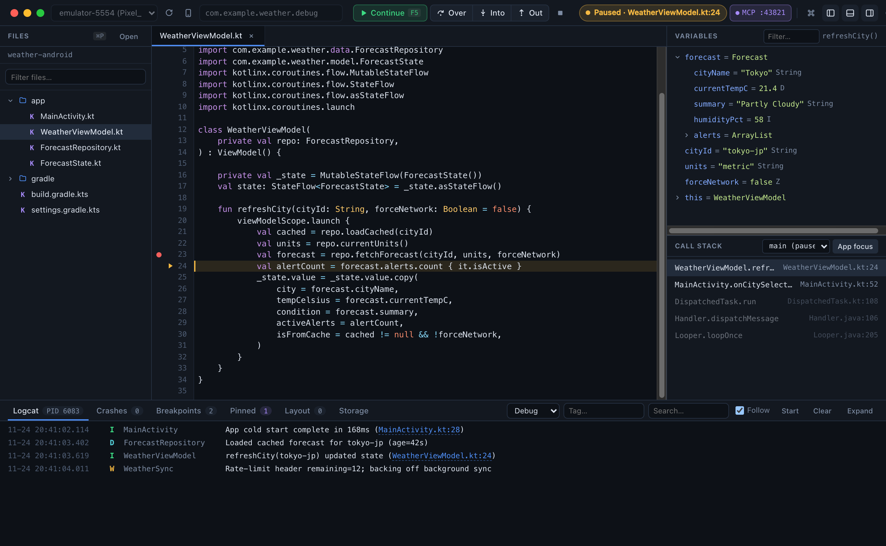

# android-lens

A lightweight (<150 MB RAM), open-source Android debugging companion built in Rust + Tauri v2 for developers who use agentic AI coding tools (**Claude Code**, **Antigravity**, **Codex**, etc.) instead of Android Studio.



## Why android-lens?

When an AI coding agent handles code edits, refactoring, and `./gradlew` builds, you no longer need Android Studio's heaviest components (IntelliJ indexing, PSI/AST, 8–14 GB RAM footprint). What you still need is a fast, visual **runtime debugging companion**—and a way for both you and your AI agent to inspect the **same live debug session**.

- **Pure-Rust JDWP engine:** Async step-through debugging (`.kt`/`.java` line breakpoints, `ClassPrepare` pending breakpoints, `am start -D` startup debugging, step over/into/out, call stacks, local variables, superclass object & array inspection) over `adb` with zero JVM overhead.
- **Dual-interface (Human + AI Agent):** Built-in local **MCP server** sharing the live `DebugSession`, logcat ring buffer, and **"Pin to Agent"** context with the desktop UI.
- **Calm, low-RAM desktop UI:** Tauri v2 + read-only **CodeMirror 6** viewer (~100 KB gzipped frontend), draggable splitters, 5 curated themes + System Auto, `⌘K` command palette, `⌘P` quick file open, `⌘F` find, and clickable logcat stack traces.
- **Visual & App State Inspector:** One-click `scrcpy` screen mirror, `uiautomator` interactive screenshot bounding-box overlay, and `adb shell run-as` browser for SharedPreferences, Jetpack DataStore (`.preferences_pb`), and read-only SQLite databases.

---

## Architecture

```text
[Tauri v2 UI]  <──IPC──>  [SharedLensState (Rust / tokio)]  <──MCP──>  [Claude Code / Antigravity]
                                       │
          ┌────────────────────────────┼────────────────────────────┐
          ▼                            ▼                            ▼
     adb-bridge                   jdwp-client             logcat-stream / app-inspector
          └────────────────────────────┴────────────────────────────┘
                                       │ adb forward tcp:PORT jdwp:PID
                                       ▼
                           [Android Device / Emulator (ART)]
```

### Workspace Crates

| Crate / App | Responsibility |
| :--- | :--- |
| [`crates/adb-bridge`](./crates/adb-bridge) | Device discovery, package listing, launcher activity resolution, `pidof`, `am start -D -S`, RAII `JdwpForwardGuard` |
| [`crates/jdwp-client`](./crates/jdwp-client) | Pure-Rust async JDWP wire protocol, dynamic `IDSizes`, 2-pass source-line resolution, `ClassPrepare`, stepping, object/array inspection |
| [`crates/logcat-stream`](./crates/logcat-stream) | Package-scoped `adb logcat --pid` ring buffer, auto-reattach on app restart, level/tag/text filtering, crash stack grouping |
| [`crates/app-inspector`](./crates/app-inspector) | `scrcpy` launcher, parallel screenshot + `uiautomator` XML parser, `run-as` SharedPreferences / DataStore protobuf / SQLite browser |
| [`crates/mcp-server`](./crates/mcp-server) | Shared `DebugSession` + `PinnedContextStore`, embedded localhost HTTP MCP server (`127.0.0.1:43821/mcp`), and `android-lens-mcp` stdio bridge/standalone binary |
| [`crates/cli-poc`](./crates/cli-poc) | Interactive terminal JDWP debugger REPL |
| [`apps/desktop`](./apps/desktop) | Tauri v2 desktop app with read-only CodeMirror 6 viewer, resizable panels, 5 themes, Pin to Agent, Layout & Storage inspectors |

---

## Quick Start

### Prerequisites
- **Rust** toolchain (`rustc` / `cargo`)
- **Node.js** 20+ (for building the Tauri v2 frontend)
- **Android SDK Platform-Tools** (`adb` on `PATH`)
- Optional: `scrcpy` (one-click device screen mirror), `sqlite3` (SQLite table browsing — pre-installed on macOS)
- A connected Android device or emulator running a **debuggable Kotlin/Java app** (`debuggable = true`)

### 1. Run the Desktop App
```bash
cd apps/desktop
npm install
npm run tauri dev
```

To build a native release bundle (`.app` / `.dmg`) and release MCP binary:
```bash
cargo build --release -p mcp-server
cd apps/desktop && npm run tauri build
```

### 2. Connect Claude Code / Antigravity via MCP
Build or install the `android-lens-mcp` binary (`cargo build --release -p mcp-server` → `target/release/android-lens-mcp`) and add it to your MCP configuration:

```json
{
  "mcpServers": {
    "android-lens": {
      "command": "/path/to/android-lens/target/release/android-lens-mcp",
      "args": ["--desktop-port", "43821"]
    }
  }
}
```

- When the **Desktop UI is open**, `android-lens-mcp` transparently proxies to the live desktop session—so AI-triggered breakpoints/steps show up live in your editor, and items you click **Pin** on are returned by `get_pinned_context()`.
- When the **Desktop UI is closed**, `android-lens-mcp` automatically falls back to headless standalone mode (pass `--project /path/to/android/app` to include source snippets).

#### Exposed MCP Tools
- `debug_attach` — attach to a running app or launch with `am start -D` (also starts logcat)
- `debug_set_breakpoint` — set or remove `File.kt:line` breakpoints (supports pending `ClassPrepare`)
- `debug_step` — `over`, `into`, `out`, `resume`, or `pause`
- `debug_get_state` — paused thread, call stack, source snippet around active line, local variables, breakpoints
- `debug_inspect_object` — recursive field & array expansion (`depth` 1–3) with cycle protection
- `logcat_tail` — package-scoped logcat entries + grouped fatal crashes
- `get_pinned_context` — stack frames, variables, logcat lines, crashes, UI nodes, and storage entries pinned by the developer

### 3. Interactive CLI Debugger (Optional)
```bash
# List connected devices
cargo run -p cli-poc -- devices

# List third-party packages
cargo run -p cli-poc -- packages --filter example

# Attach to a running app or launch at startup with a breakpoint
cargo run -p cli-poc -- attach --package com.example.app -b MainActivity.kt:27
cargo run -p cli-poc -- attach --launch com.example.app/.MainActivity -b MainActivity.kt:27
```

---

## Keyboard Shortcuts

| Shortcut | Action |
| :--- | :--- |
| `⌘K` | Command Palette |
| `⌘P` | Quick Open File |
| `⌘F` | Find in File |
| `⌃G` | Go to Line |
| `F5` / `F10` / `F11` / `⇧F11` | Continue / Step Over / Step Into / Step Out |
| `⌘B` / `⌘J` / `⌘⌥B` | Toggle Files Rail / Bottom Dock / Right Inspector |
| `⌘+` / `⌘−` / `⌘0` | Code Font Size |
| `⌘/` | Shortcuts Reference |

---

## Development

```bash
cargo test --workspace
cargo clippy --workspace --all-targets -- -D warnings
cargo fmt --check
(cd apps/desktop && npm run build)
```

See [TASKS.md](./TASKS.md) for the roadmap and [AGENTS.md](./AGENTS.md) for engineering guidelines.

## License

MIT
